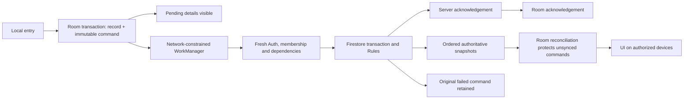

# Offline synchronization repair and release verification

Current repository: Thiru-Selvam-06/aidhunt-trac-release. Baseline main: `24d7b91`. Development branch: `codex/offline-sync-reliability`; [draft PR #3](https://github.com/Thiru-Selvam-06/aidhunt-trac-release/pull/3).

## Current status

Application implementation commit `3712901fba157138447cf7e8b8878518feb02211` passed the complete [Android CI run](https://github.com/Thiru-Selvam-06/aidhunt-trac-release/actions/runs/39432672198): all ten jobs, including 17 Android emulator tests and the aggregate gate. The source now declares version 1.0.8/code 9, matching the signed APK's effective packaging configuration. This publication follow-up changes version metadata and documentation only. Its CI is visible in the PR checks.

After explicit user approval, the tested Firestore Rules were deployed to `trac-aidhunt` and read back byte-for-byte. Production release APK assembly, release lint, original signing certificate, package/version, production Firebase resources, disabled test/debug flags, ZIP integrity and 16 KB alignment passed. [Release notes and evidence](releases/1.0.8/release-notes.md) record the APK hash and deployment details. The APK is distributed as a prerelease while physical-phone acceptance remains manual. The development branch has not been merged to main.

## Confirmed causes

1. `validCollectionCollector` required a redundant `workspaceId` field absent from valid legacy workspace membership documents. The membership path already scopes the member to the workspace. Baseline Rules rejected isolated Owner and Partner receipts with `Property workspaceId is undefined`; the corrected Rules accept the same valid commands while rejecting explicit foreign metadata, inactive membership and unauthorized collectors. The deployed Rules matched baseline source during diagnosis: a deployment/source mismatch was not the current cause.
2. A legitimate Owner tractor job for another active partner failed during repeated customer/tractor reference lookups. An independent Rules reproduction failed before the change and passed after one fetched map was reused per reference. Missing/deleted/foreign references remain denied. The emulator exposed a service-call error; its internal access-call counter was not exposed, so the exact counter is not claimed.
3. `OfflineEntryRecovery` restores cloud-confirmed rows. When no server job exists, it removes the optimistic ordinary row while preserving the immutable command in `pending_operations`. Ordinary job screens therefore hid the rejected job. The retained command now remains readable on Home and in Sync details without adding rejected money to confirmed balances.
4. Permission-rejected payments were counted as blocked children, and job acknowledgement could precede its initial collection. Review and blocked states are now distinct; financial acknowledgement observes dependent operations.
5. Background sync depended on foreground coroutines/connectivity callbacks. Attempt count could also convert a transient network failure into permanent rejection. WorkManager now schedules the original Room outbox, and failure classification uses the cause.
6. Offline job/expense edits lacked an original-base comparison; incoming snapshot coroutines could finish out of order. New edit commands capture a base for transactional comparison, financial snapshots apply serially, and expense/withdrawal reconciliation is transactional.
7. A stale customer snapshot could recreate a zero-value customer after final source/customer deletion. Reconciliation suppresses it only when an authoritative customer-deletion proof matches workspace, record ID and original creation time. A deleted job alone is insufficient proof that its customer was deleted.

The exact predicate rejecting the original inaccessible phone's JOB remains **unproven** without its retained payload, actual authenticated UID and installed APK. The original rejected payment amount was not inferred from a displayed zero. No historical attribution, amount, timestamp or operation ID was changed to make authorization pass.

## Data flow and safeguards

The existing Room command table remains the sole business outbox. IDs, original actors/workspaces, amounts, timestamps and payloads remain durable. No business database or destructive schema migration was introduced. WorkManager's internal scheduling database does not replace the ledger. The worker checks the actual Auth UID and verified workspace before using the existing repository drain/mutex; that drain rechecks server membership and dependencies. It never reopens rejected financial commands.

A collection and source-job balance update remain one atomic Firestore transaction. Stable IDs prevent normal duplicate replay. New job/expense edit bases are compared inside the transaction before replacement. Permission, validation and conflict failures remain review cases; temporary transport failures remain pending. A rejected parent blocks a dependent payment without writing or discarding it. Linked rejected financial actions intentionally continue to protect deletion.

## Executed validation and CI corrections

| Verification | Result |
|---|---|
| Full local JVM/Room/Compose suite | 619 passed; 79 classes; zero failures/errors/skips |
| Firestore Rules suite | 262 passed; valid and unauthorized cases retained |
| Backend/HTTP/deletion/migration suite | 129 passed |
| Python regression harness | 108 passed |
| Hosted Android emulator journeys | 17 passed; API 35; complete CI gate passed |
| Production APK build and release lint | Passed; zero lint errors, 101 warnings |
| APK signature/package/version/configuration | Original release certificate; version code 9; real Firebase; test/debug flags false |
| Physical installation/login/two phones | Not verified; user chose downloadable APK |

The real repository journey saves an offline job, initial collection and business expense, then waits for automatic acknowledgements without a manual push. It asserts original operation IDs, immutable payloads/times, authoritative amounts, one receipt, safe duplicate replay, a newly completed background task, and a separately authenticated partner replica. File-backed Room reopen, cached-session restoration, wrong-account isolation, rejected dependency preservation, conflict and deletion-proof cases also passed. Two authenticated clients in one journey do not substitute for two physical phones.

CI failures were investigated without removing tests. Baseline inventory drift and an empty server-only value generating invalid BuildConfig Java were corrected. Outbox CI configured a Firestore host without starting the emulator; tests and coverage now run inside the emulator lifecycle. Synthetic deletion fixtures were aligned with the existing workspace/linked-record protocol, while invalid/shared receipts remained denied. A secondary test FirebaseApp lifetime and missing synthetic expense date were corrected. A device assertion exposed the real stale-customer reconciliation defect. The automatic acknowledgement test originally used `observeActor`, whose SQL excludes acknowledged rows; it now reads full durable history. The final complete implementation run passed every job.

Existing JUnit, Robolectric, Room, Compose, Firebase emulators, Rules/backend tests and GitHub Actions were reused. WorkManager runtime/testing is the only new library family: free, moderate app-only integration, no hosted-service or billing change. Android Studio inspectors could not inspect the original phone because ADB did not expose it. No monitoring service was added. Existing Cloudflare staging preview automation still fails because its configured preview command lacks a `previews` block; that unrelated configuration was not changed.

## Files changed for the implementation

Paths below are relative to the current repository. Generated evidence and private inspection helpers outside Git are not application changes.

| File | Reason |
|---|---|
| `.env.example` | Quote the empty server-only invitation CSV example. |
| `.github/workflows/android-ci.yml` | Provision Firestore for outbox tests and coverage; retain every partition and release gate. |
| `app/build.gradle.kts` | Declare version 1.0.8/code 9; exclude the unused server-only CSV from Android BuildConfig generation; add WorkManager dependencies. |
| `gradle/libs.versions.toml` | Pin WorkManager runtime/test library version. |
| `app/src/main/java/com/example/TracApplication.kt` | Start durable scheduling after the correct Firebase environment initializes. |
| `app/src/main/java/com/example/MainActivity.kt` | Pass retained actions into Home. |
| `app/src/main/java/com/example/data/dao/PendingOperationDao.kt` | Observe existing pending commands for scheduling. |
| `app/src/main/java/com/example/data/firebase/FirestoreRepository.kt` | Check queued job/expense edit bases; read authoritative customer-deletion proofs; keep helper metadata local. |
| `app/src/main/java/com/example/data/network/NetworkMonitor.kt` | Require validated connectivity; unknown state is not treated as online. |
| `app/src/main/java/com/example/data/repository/WorkspaceRepository.kt` | Serialize reconciliation, transact expense/withdrawal merges, preserve retry policy, improve diagnostics/dependency acknowledgement and manual recovery checks. |
| `app/src/main/java/com/example/data/sync/QueuedWriteConflict.kt` | Compare the original business snapshot and exact numeric identities; fail stale edits closed. |
| `app/src/main/java/com/example/data/sync/ConfirmedEntryDeletion.kt` | Match exact server customer-deletion proofs before suppressing stale snapshots. |
| `app/src/main/java/com/example/data/sync/ReplicaDispatcher.kt` | Apply financial snapshots in delivery order. |
| `app/src/main/java/com/example/data/sync/SyncAuthorizationDiagnostic.kt` | Retain useful authorization-stage evidence without logging tokens or customer contact fields. |
| `app/src/main/java/com/example/data/sync/SyncFailurePolicy.kt` | Classify failures by cause rather than attempt count. |
| `app/src/main/java/com/example/data/sync/WorkspaceSyncWorker.kt` | Schedule/drain the original outbox with network, actor and workspace constraints. |
| `app/src/main/java/com/example/ui/viewmodel/MainViewModel.kt` | Observe background sync, verified retained actions and correct blocked status. |
| `app/src/main/java/com/example/ui/screens/home/HomeScreen.kt` | Show retained pending/rejected actions without adding them to confirmed totals. |
| `app/src/main/java/com/example/ui/screens/account/AccountScreen.kt` | Display original retained command details. |
| `app/src/main/java/com/example/ui/util/RetainedActionDetails.kt` | Project original payload details and distinguish pending, blocked and review states. |
| `firestore.rules` | Accept valid path-scoped legacy membership; reuse reference lookups without dropping authorization predicates. |
| `security-tests/architecture.test.cjs` | Test legacy membership, foreign metadata denial, Owner/Partner tractor jobs and invalid reference denial. |
| `app/src/test/java/com/example/OfflineSyncReliabilityTest.kt` | Test durable reopen, original payload preservation, actor isolation, retry classification, worker sign-out and conflicts. |
| `app/src/test/java/com/example/ReplicaSyncOrderingTest.kt` | Verify ordered application and isolation after a failed snapshot. |
| `app/src/test/java/com/example/BusinessOverviewChartMembersTest.kt` | Align fixtures with existing known-member chart behavior; preserve unknown source data. |
| `app/src/test/java/com/example/CollectionFormRegressionTest.kt` | Supply valid source-job fixtures required by the existing form. |
| `app/src/test/java/com/example/CollectionHistoryDetailsTest.kt` | Supply valid source jobs and test the existing orphan filtering behavior. |
| `app/src/androidTest/java/com/example/DeviceEmulatorIntegrationTest.kt` | Exercise real offline job/payment/expense repository flow, acknowledgements and separate authenticated replica; align synthetic workspace ID and explicit journey order. |
| `app/src/deviceTest/res/xml/device_test_network.xml` | Fix lint by explicitly limiting the two test-only loopback domains. |
| `functions/device-test-fixtures.cjs` | Use a synthetic workspace ID accepted by the current deletion protocol. |
| `scripts/test_regression_harness.py` | Guard the requirement to start Firestore around outbox tests and coverage. |
| `docs/regression/asset-inventory.json` | Regenerate inventory after UI/dependency changes. |
| `docs/regression/interaction-inventory.csv` | Regenerate current interaction locations. |
| `docs/regression/interaction-inventory.json` | Regenerate current interaction locations. |
| `docs/OFFLINE_SYNC_RELIABILITY.md` | Record evidence, architecture, limitations, validation and safe recovery/release gates. |

Publication additionally records release notes, checksum, APK verification, Rules deployment and scoped Rules assessment under `docs/releases/1.0.8/`. Generated inventories identify current controls and are not proof of UI coverage. Signing credentials, raw private logs and live data exports are not publication artifacts.

## Safety, remaining limits and recovery

Production inspection was read-only until the user explicitly authorized Rules deployment. Only the reviewed Rules were deployed. No customer record, live pending action, historical financial value or attribution was edited, deleted or recovered. Billing and backend deployments remain unchanged. The APK has not been installed by this task.

True process death, force-stop/reboot, manufacturer battery restrictions, actual phone login and two-device convergence require physical acceptance. Existing client action-time trust, incomplete legacy text-size bounds, nonfinancial customer/asset concurrent edits and arbitrary old/custom-client conflict protocols remain documented limitations. An interleaved lost acknowledgement can require review; no universal immutable operation-receipt registry was added. Pre-upgrade edits without a trustworthy base fail closed rather than inventing one. Historical expenses missing their original date require review, not fabricated timestamps.

Before any live recovery, preserve the original queue/rows; verify actual Auth UID, original actor/workspace and the full original command; read current source/dependencies, membership, deletion proofs and existing receipt from the server; compare exact IDs, times, attribution, amounts and balances. An existing receipt must be reconciled, never collected again. Stop for review if balances differ, a parent is rejected or identity is ambiguous. Verify the exact command in isolation, recover its parent first, then authorize the original financial action only after checking the server again. The app's manual collection recovery adds source-balance and parent checks; no live rejected action is automatically retried.

Keep the previous signed APK and Rules backup for rollback. Preserve newer pending operations and never destructively downgrade Room. Any live recovery, additional deployment or merge requires its own explicit authorization.

I've set up prototype Security Rules to keep the data in Firestore safe. They are designed to be secure for active workspace membership, existing role/collector restrictions and atomic collection balances. However, you should review and verify them before broadly sharing your app. If you'd like, I can help you harden these rules.
