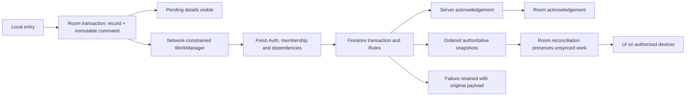

# Offline synchronization repair — development review

Baseline: current collaborative repository, main commit `24d7b91`. Development branch: `codex/offline-sync-reliability`.

## Confirmed findings

1. Collection authorization required `target.workspaceId == ws`, although valid legacy membership documents are scoped by `workspaces/{ws}/members/{uid}` and omit that redundant field. A read-only production rules comparison found no source/deployment mismatch. In an isolated emulator reproduction, the baseline rejected both Owner and Partner collections with `Property workspaceId is undefined`. The development rule accepted the same synthetic commands and atomically updated the receipt and source balance. Explicitly foreign membership metadata remains denied.
2. On rejection, `OfflineEntryRecovery` restores the confirmed row, or removes the ordinary optimistic job row if the server has none. The original command JSON remains in `pending_operations`. Normal job lists read the job table, explaining the disappearance without loss of the original queue snapshot.
3. The previous blocked counter counted permission-rejected payments instead of pending dependent operations. A job acknowledgement could also mark its local financial state synced before its initial collection completed.
4. Background execution previously depended on app coroutines and foreground network callbacks. No durable WorkManager sync worker existed. A fourth failure could permanently reject an operation even when the latest error was transient.
5. Offline job/expense updates had no comparison against the original edit base. Listener callbacks launched independent coroutines, allowing full snapshots to finish out of order. Expense and withdrawal reconciliation read pending rows outside a Room transaction.
6. Deletion protection against rejected linked financial operations is intentional. It is retained, with a clearer explanation.

The exact predicate rejecting the reported original job is **not proven**: its retained payload, actual device Auth UID and installed APK could not be read through ADB. No identity reassignment, timestamp correction or rules relaxation is justified by that screenshot alone.

## Minimal architecture corrections

- The existing Room command table remains the only business outbox. Its IDs, amounts, actor/workspace, timestamps and payloads are not rewritten. No business schema migration or destructive fallback was added.
- WorkManager schedules network-constrained work, uses the same repository drain/mutex, checks the original actor and verified active workspace, and never reopens rejected commands. Periodic work is a safety net, subject to Android scheduling constraints.
- Pending and rejected command summaries are visible on Home. The sync screen displays original customer/job/payment information and identity evidence. Restored confirmed ledger rows remain separate from rejected snapshots.
- New job/expense edits capture their original business snapshot. The existing Firestore transaction compares it before replacement. Stale writes become explicit review cases. Pre-upgrade edits without a trustworthy base fail closed; absent new creates can still upload.
- Receipt creation and its job balance remain one atomic Firestore transaction. Existing stable document/operation IDs prevent normal duplicate application. An interleaved lost acknowledgement that cannot be proven from current state requires review; no blind overwrite or guessed recovery is introduced.
- Listener updates are serialized and expense/withdrawal reconciliation is transactional. Existing authoritative-only snapshot filtering and workspace isolation remain in force.
- Temporary transport failures remain pending regardless of count. Permission/validation/conflict failures require review. Blocked children retain their original payload and do not acquire a write attempt.

## Tests and tools

Reuse the existing Android/JUnit/Room/Compose, Firebase Emulator, Rules, backend and GitHub Actions gates. WorkManager 2.12.0 and its test helper are the only new library family: free, moderate app integration, no new hosted service or production configuration. Its internal scheduling database does not replace or duplicate the business outbox. No monitoring vendor or HTTP testing product was added.

New tests cover legacy path-scoped membership, explicitly foreign metadata denial, durable retained job/payment details after reopen, original IDs/timestamps/amounts, actor isolation, transient errors, rejected versus blocked status, exact 64-bit identities, stale edit conflicts and ordered snapshots. The Android integration journey additionally exercises actual repository offline creation, a collection and business expense, acknowledgements, duplicate replay and an independently authenticated partner replica.

Initial full Android run: 617 tests executed, 606 passed and 11 failed. Four failures exposed stale fixtures/expectations conflicting with the already-approved source behavior (known-member charts, hidden orphan collection groups, negative synthetic legacy receipt IDs). Seven were file-backed SQLite failures at Windows path lengths of 260–298 characters. Fixtures were corrected without removing their assertions; a shorter local test temporary directory is used for reruns. Final results must be taken from executed evidence, not this initial run.

The existing CI run on baseline main failed first in the interaction-inventory job (inventory drift), then Android builds failed before tests because the empty `INVITATION_TEST_PHONES` generated `public static final String INVITATION_TEST_PHONES = ;`. The inventory is regenerated and the unused server-only CSV is excluded from Android BuildConfig generation. The full CI regression/release gate is retained.

## Safety, recovery and release gates

No production deployment, APK installation, live transaction retry/recovery, record deletion, queue reset, amount change or attribution change is part of this development work. Read-only cloud inspection does not recover a retained action.

Before any approved recovery: preserve the original queue export; sign in as its original actor/workspace; read the source, parents, membership, deletion proofs and existing receipt from the server; compare exact IDs, action time, amount and balances; verify the corrected policy in an isolated emulator. If an original receipt already exists, reconcile its acknowledgement instead of applying the amount again. If source balances differ or a parent is rejected, stop for review. Recover a parent first, then explicitly authorize its original dependent payment. Never recreate a guessed entry or edit historical identity to make authorization pass.

Keep this PR as a development candidate until full tests/build/lint, the Android CI device journey and the reported physical-phone scenarios are verified. ADB currently exposes no phone; the local Android emulator cannot boot with available hardware acceleration. These are separate limitations from the running Firebase Emulator Suite. Do not merge, deploy production Rules or release an APK based only on local unit/Rules success. Retain the prior signed APK/rules version for rollback; rollback must also preserve newly created pending actions and must not downgrade Room destructively.

The existing Rules retain a documented client-action-time trust limitation. New app-side snapshot comparison is not a new server-side conflict protocol for arbitrary legacy/custom clients. Concurrent nonfinancial customer/asset edits and physical manufacturer background restrictions need additional acceptance verification.

I've set up prototype Security Rules to keep the data in Firestore safe. They are designed to be secure for active workspace membership, existing role/collector restrictions and atomic collection balances. However, you should review and verify them before broadly sharing your app. If you'd like, I can help you harden these rules.
