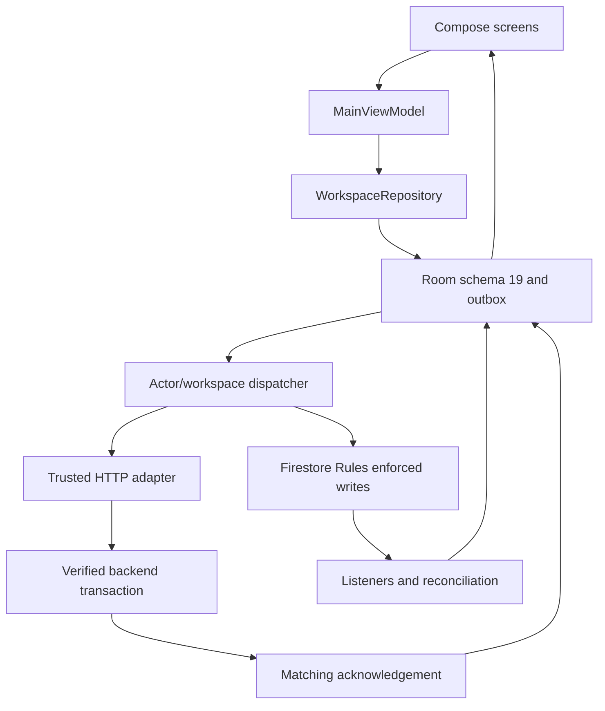

# 2. Architecture and source map

Compose screens call MainViewModel. WorkspaceRepository coordinates workspace state, Room and synchronization. Firebase Auth supplies identity. Firestore supplies shared records and membership. Trusted operations perform privileged transactions that clients must not replace with weaker writes.

| Area | Source |
|---|---|
| UI/navigation | ui/screens and MainActivity.kt |
| State | ui/viewmodel/MainViewModel.kt |
| Workspace/commands | data/repository/WorkspaceRepository.kt |
| Identity | data/firebase/FirebaseAuthService.kt and AuthRepository |
| Routing | data/firebase/FirebaseEnvironment.kt |
| Contracts | WorkspaceCommandService, WorkspaceCommandProtocol, WorkspaceInvitationService |
| Database | data/database/AppDatabase.kt; data/entity; data/dao |
| Queue/recovery | data/sync, PendingDeleteManager and repository |
| Calculations | ui/util/FinancialCalculationEngine.kt |
| Backend | functions/index.js, invitation-policy.js, entry-deletion-policy.js |
| Worker | cloudflare/worker.mjs, operations.mjs, firestore-rest.mjs, google-auth.mjs |
| Enforcement | firestore.rules and security-tests |

Room v19 contains partners, tractors, customers, jobs, expenses, withdrawals, settings, payments, checklist items, work extensions, pending operations and deleted members. Inspect composite keys and every DAO workspace parameter before editing.

Firestore business records live under workspaces/{workspaceId}. Root ownerUid and members establish authority; userWorkspaceMemberships is a discovery index. users and phoneDirectory are global identity/profile data, not global workspace roles.

Android Long IDs can exceed JavaScript exact Number range. Backend decimal strings/BigInt and Firestore integerValue preserve them. Never round-trip them through floating point.

Change shared contracts with regression evidence. UI hiding is not enforcement; an HTTP success alone does not prove reopened local state or ledger consistency.
