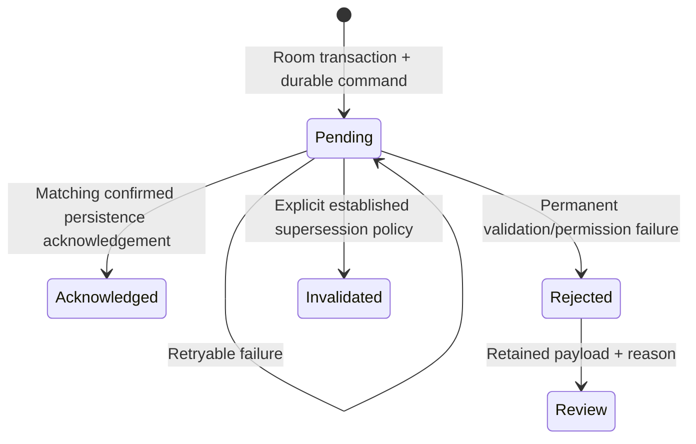

# 5. Durable offline commands

Online/offline actions retain the same logical contract: operationId, original actionTime, workspace, authenticated actor, operation/entity type, exact target ID, protocol and dependency metadata. A retry cannot regenerate identity/time to evade authorization.

This is conceptual; consult actual entity/DAO constants.

Home/Recent Jobs compound deletion must use the same shared command path and eligible linked Expenses. No redundant child Expense DELETE commands. Keep recoverable local state when server rejects it. Shared allocations and authoritative dependencies stay protected.

A local disappearance/toast is not cloud success. Validate operation identity, timestamp, workspace and target before acknowledgement. Malformed/mismatched/missing acknowledgements retain pending state. An unstructured endpoint 404 means backend unavailable, not target deletion success.

Prevent stale listeners/older uploads recreating acknowledged deleted records. Inspect Room and server state after retry/restart independently.

Pending counts are actor/workspace-scoped and include DELETE, not only UPSERT. Owner pending and Partner synced can both be accurate. Do not clear another actor's queue to align badges. Retain rejected payloads, original scope and actual reasons; distinguish server failure from SQLite corruption.

Architecture retains client-recorded original actionTime for offline 24-hour eligibility. The user accepted its clock-manipulation limitation. Do not call it trusted server-time security or silently replace it with server receipt time.

A valid Firebase session can restore authorized cached data under policy; Room cache alone cannot authenticate. Switching accounts/workspaces must not reroute commands. Test delayed callbacks, revoked membership and distinguishable ledgers.
